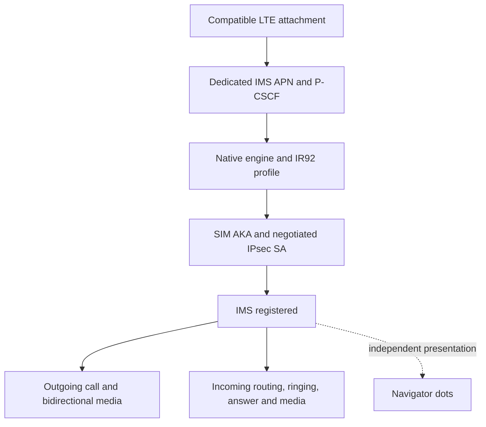

# Findings and experiment sequence

[Home](../README.md)



## 1. Configuration made the native IMS engine usable

The initial local target was a rooted Classic AT&T on BB10 10.3.3.3216 with a
China Mobile 460-00 SIM. LTE worked before the IMS changes.

The successful configuration declared a voice service with the MMTel feature
tag and `network:["LTE"]`. The array representation mattered in the observed
parser. The source file was:

`/var/dca/sources/ims/services/carrier_config/ims/ims`

```text
@ims
IMS_services:json:[{"service":"voice","feature_tag":"urn:urn-7:3gpp-service.ims.icsi.mmtel","network":["LTE"]}]
Mobility_Management_IMS_Voice_Termination:n:1
IMS_profilesV2:json:["IR92"]
supported_networks:json:["LTE"]
PCSCF_discoveryV2:json:["PCO"]
SDK_Config::3GPP
IMS_always_on:b:true
```

Without a usable profile, the IMS process had waited for provisioning and
exited. `IMS_platform::common` was added under the `test` source's
`services/carrier_config/radio_qct/ims` object. Four source trees received the
same radio-common configuration to avoid a higher-priority source retaining
the previous voice-domain preference. The precedence of all DCA sources has
not been exhaustively mapped.

`dca -s -a /pps` published the aggregate. The important observations were the
published PPS values and engine behavior; a warning about a missing `sls`
source alone did not mean aggregation had failed.

## 2. A dedicated IMS bearer was needed

The device's `/etc/carrier/config/404.xml` pointed the `ims` alias at `internet`,
which used `cmnet`. The experiment replaced only that alias with an independent
IMS service in a writable copy of the carrier XML:

- APN `ims`, IP type `IPv4v6`;
- protected routing and DAD disabled for that interface;
- P-CSCF discovery and signalling-bearer requests through PCO;
- normal internet service retained separately.

The runtime selector was `cdsc_xml` in
`/pps/services/cds/cnice/status_persistent`. A `NetworkServiceFilter` copied
from another template initially prevented the intended PCO request on this
target; removing it allowed the requests. This is a target-specific result,
not proof that the field is always wrong.

The network accepted the IMS APN, supplied IPv6 P-CSCF addresses, and issued an
IMS AKA challenge. Those addresses and authentication exchanges are excluded
from the public archive.

## 3. Error 22 was a crypto-provider failure

The network selected:

```text
ipsec-3gpp; alg=hmac-sha-1-96; prot=esp; mod=trans; ealg=null
```

The engine failed during SA setup:

```text
vpn_adapter_cmd/setup_sa failed, error: 22
Could send to pfkey but it returned error [22]: Invalid argument
```

NULL here means no ESP encryption for this negotiated profile. HMAC-SHA1
integrity and SIM-based IMS authentication were still present. The work did
not bypass AKA or replace the SIM's identity.

A synthetic AES + HMAC-SHA1 SA could be created after supplying valid
lifetimes, but NULL + HMAC-SHA1 still failed. An additional NULL encryption-key
argument was not valid `setkey` syntax and was not useful evidence.

The boot script contained:

```sh
mount -T io-pkt -o disable_swcrypto=1 /lib/dll/devnp-sbgse_drv.so
```

In a separate io-pkt namespace with no physical interfaces, NULL SA creation
worked. Unregistering the software provider made it fail; registering it again
restored it. The primary stack stayed running during that comparison.

The small `devnp-volte-swcrypto.so` loader calls functions already compiled into
the target stack: `swcryptoattach(0)` and, for the original reversible test,
`crypto_unregister_all(swcr_id)`. It does not implement ciphers, intercept
packets, or patch the firmware executable. Registering the built-in provider
on the main Classic stack resolved SA creation; IMS subsequently registered.

**Unloading is not portable:** the contributed Passport notes report an
io-pkt restart and USB interruption when disabling the provider. That variant
deliberately leaves the provider loaded until reboot. Do not treat the
Classic's successful disable experiment as a guarantee on other firmware.

## 4. A real outgoing call was observed

The original local session recorded a connected/disconnected phone call,
AMR/8000 media, and 4,451 received / 4,500 sent RTP packets. The user confirmed
the call worked. These counts are retained as a session observation, not a raw
public packet capture. A Qt auto-call helper crashed during initialization,
before dialing; the successful call was manual. That failed helper is not a
recommended reproduction tool.

Incoming calls were not established by this test. Later feedback reports Q20
incoming failures. See the separate [incoming-call analysis](03-incoming-calls.md).

## 5. The original BlackBerry dots can be repurposed

Static analysis of the locally obtained `io-bb` identified
`update_bb_service` at virtual address `0x133e8`, size `0x33c`, in that specific
binary. It wrote:

```text
/pps/system/navigator/status/bb_service
[n]dat:json:{"bb_service":{"state":"on"}}
```

The alternate state is `off`. The original function used RCP state text:
`0x03 connected` enabled the dots; `0x04 reconnecting` preserved their state.
Its log was `bbio_internal: %s: %s dots`.

The native monitor reads public IMS status and updates only this presentation
attribute every two seconds. It does not claim BBM/BIS authentication. The
user observed dots disappear and return during airplane-mode testing.

The preserved baseline C monitor compares `default_ran` with uppercase `LTE`.
A fresh Q20 snapshot in this handoff reports lowercase `lte`. That is a known
case-sensitivity limitation, separately documented rather than silently
rewriting the historical source.
